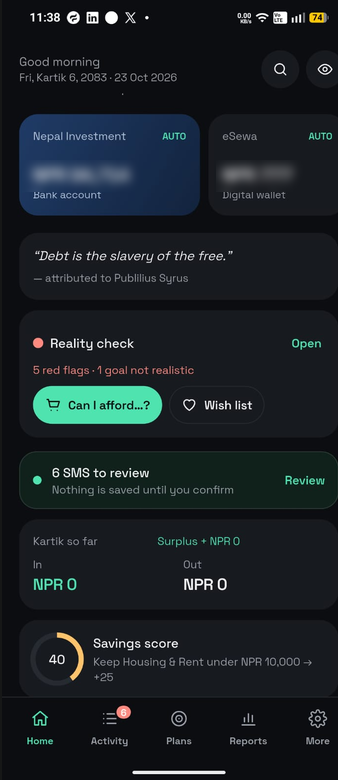
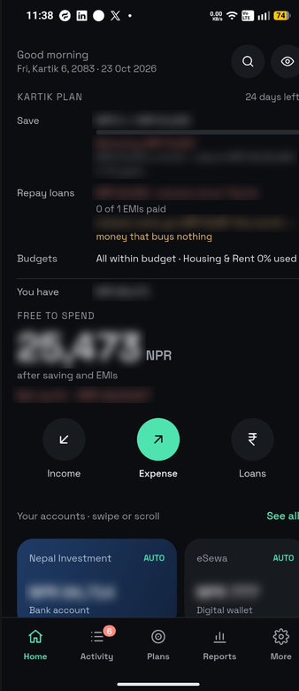
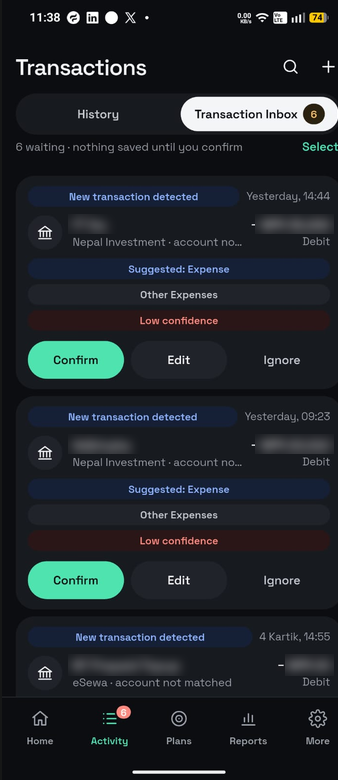
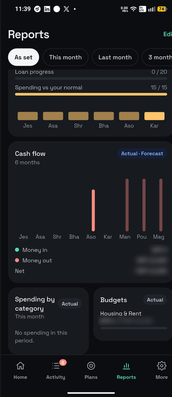
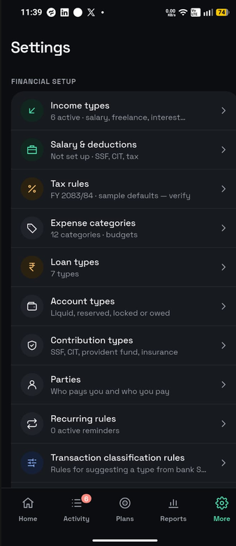

# Paisa

An open-source personal finance app built for Nepal. It reads your bank SMS and wallet notifications so you don't have to type every transaction yourself.

**Current version:** 2.0.1 (build 14)

## Why Paisa?

Most finance apps make you enter every transaction by hand. People give up after a week, and the numbers stop matching their bank.

In Nepal, almost every payment already leaves a trace: a debit or credit SMS from your bank, or a notification from eSewa or Khalti. Paisa reads those messages on your phone and turns them into suggested transactions in a **Transaction Inbox**. You confirm, edit or ignore each one. Nothing is saved until you confirm.

You can still add transactions by hand for cash and anything else.

Paisa is also built for how money works here: Bikram Sambat months, the fiscal year from 1 Shrawan, NPR formatting (lakh and crore), SSF and CIT, EMIs, and local banks and wallets.

If you add your own Gemini API key, the AI features make the app more personal. They explain your spending, answer questions about your money and suggest what to do next. AI is off by default, and the app works fully without it.

Everything stays on your phone. There is no account, no server and no tracking.

## Screenshots

> Amounts and payee names are blurred.

| Home | Month plan | Transaction Inbox | Reports | Settings |
| :---: | :---: | :---: | :---: | :---: |
|  |  |  |  |  |

## Features

- **Accounts and net worth.** Bank accounts, wallets and cash, with reconcile, archive and net worth (shown in red when negative).
- **Income and expenses.** Take-home or gross salary modes, pending income, categories with budgets, monthly repeats, and parties ("Received from" / "Paid to").
- **Loans.** EMIs, a payoff planner, interest cost and the next due date.
- **Transaction Inbox from SMS.** Reads Nepali bank SMS (NIMB, Global IME and others) plus eSewa and Khalti notifications, masks sensitive details, detects duplicates and own-account transfers, and lets you confirm, edit or bulk-ignore messages with undo.
- **Bikram Sambat calendar.** BS months across the app (the default for new installs), or AD if you prefer. The fiscal year starts on 1 Shrawan.
- **Home month plan.** Savings target with behind/ahead tracking, EMIs left, budgets, and how much is free to spend after saving and EMIs.
- **Reports.** A dashboard you can edit (12 widget types, drag to reorder), cash flow with a forecast, category reports, a monthly savings score, nudges and monthly challenges with streaks and badges.
- **Reality check.** "Can I afford it?" (verdict, work hours, goal delay, 10-year cost), a wish list, habits, goal verdicts, and budget plans from 50/30/20, zero-based or avalanche.
- **Learn.** 20 lessons on money in Nepal with sources, saving quotes, and a 24-hour waiting list.
- **AI (optional).** Insights, chat, lesson of the day and reality answers through Google Gemini. Data is redacted before it is sent.
- **App lock.** Biometric or device lock, with secrets kept in secure storage.

## Tech stack

| Area | Package |
| --- | --- |
| State | `flutter_riverpod` |
| Navigation | `go_router` |
| Database | `drift` / `drift_flutter` (SQLite) |
| Charts | `fl_chart` |
| Nepali dates | `nepali_utils` |
| Security | `flutter_secure_storage`, `local_auth`, `crypto` |
| AI | Gemini REST API via `http` |

## Project layout

```
lib/
  main.dart, app.dart, router.dart   App entry, theme and routes
  finance/        Pure finance maths (ledger, loans, payoff, tax, budgets, reports, score, nudges, reality…)
  data/           Drift database, repositories, seed data, undo and audit log
  store/          Riverpod providers and controllers
  sms/            SMS parsing, masking and treatment rules
  integrations/   Gemini client, prompts, schemas and redaction
  content/        Lessons and quotes
  ui/             Design system (tokens, theme, components, icons) and screens
test/             Unit and widget tests, mirroring lib/
tool/             Helper scripts (e.g. make_icons.sh)
```

## Getting started

### Prerequisites

- Flutter SDK with Dart `^3.13.5`
- Android SDK and a device or emulator (the SMS features need a real Android phone)

### Run

```bash
flutter pub get
flutter run
```

### Code generation

The Drift database code (`lib/data/db/database.g.dart`) is generated. After changing the tables, run:

```bash
dart run build_runner build --delete-conflicting-outputs
```

### Analyze and test

```bash
dart analyze
flutter test
```

> If `flutter analyze` crashes because the project path contains an em dash, use `dart analyze` instead.

### Build and install a release APK

```bash
flutter build apk --release
adb install -r build/app/outputs/flutter-apk/app-release.apk
```

Install with `adb`. Google Play Protect may block installing the APK by opening the file on the phone.

## Permissions (Android)

| Permission | Why |
| --- | --- |
| `READ_SMS`, `RECEIVE_SMS` | Detect transactions from bank SMS for the Transaction Inbox |
| Notification listener | Read eSewa and Khalti app notifications |
| `POST_NOTIFICATIONS` | Reminders and alerts |
| `USE_BIOMETRIC` | App lock |
| `INTERNET` | Optional Gemini AI features only |

On Android 13 and later, sideloaded apps may need **Allow restricted settings** (in the app's system info page) before SMS and notification access can be turned on.

## AI setup (optional)

1. Get a Gemini API key from [Google AI Studio](https://aistudio.google.com/).
2. In Paisa, open **More → AI assistant**, paste the key and test it. AI is off by default.

The key is stored in secure storage on the device. Everything else in the app works without it.

## Privacy

- All financial data stays on the device.
- Raw SMS text is not stored; account numbers and other sensitive details are masked.
- Only redacted summaries are sent to Gemini, and only when you have added a key.

## Contributing

Contributions are welcome, especially:

- **SMS formats from more banks and wallets.** If your bank's SMS isn't detected, open an issue with a sample message. Replace your account number, name and amounts with fake values first.
- **Tax and salary rules** for new fiscal years.
- **Translations**, including Nepali.
- Bug reports and UI improvements.

To contribute:

1. Fork the repo and create a branch.
2. Run `dart analyze` and `flutter test` before you open a pull request.
3. Keep finance logic in `lib/finance/` as pure Dart, and add tests for it in `test/finance/`.
4. Never commit real SMS, account numbers or API keys.

## License

Copyright (C) 2026 Lokesh Rawal

Paisa is free software: you can redistribute it and/or modify it under the terms of the [GNU General Public License v3.0](LICENSE) (GPL-3.0), as published by the Free Software Foundation.

In short, you may use, study, share and change Paisa, including for commercial use. If you distribute a modified version, you must release its full source code under GPL-3.0 too and keep this copyright notice.

Want to use Paisa in a closed-source product? Contact the author about a separate commercial license.
